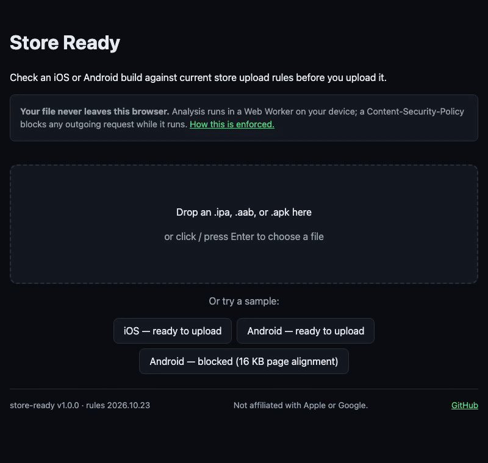

# Store Ready

Check an iOS or Android build against the current App Store Connect and Google Play upload rules before you upload it. It runs in your browser, and your file is never uploaded.



**Try it: <https://umerasiflhe.github.io/store-ready-checker/>**

[](https://github.com/umerasiflhe/store-ready-checker/actions/workflows/ci.yml)
[](https://github.com/umerasiflhe/store-ready-checker/actions/workflows/deploy.yml)
[](https://github.com/umerasiflhe/store-ready-checker/releases)
[](LICENSE)

> **Status: pre-release (v0.9.0).** The web checker is live and the CLI ships as prebuilt binaries;
> v1.0.0 follows a full re-audit of every rule against its official source. Progress is in
> [CHANGELOG.md](CHANGELOG.md).
>
> **Works today:**
>
> - The web checker on GitHub Pages: drop an `.ipa`, `.aab` or `.apk` (or try a sample), get a
>   verdict with evidence, fix steps and sources for every finding, change the "Check as of" date
>   to see upcoming deadlines, and export Markdown or JSON. It works offline once loaded, and a
>   CSP plus an automated test after every deploy prove nothing is sent anywhere.
> - The `storeready` CLI for macOS (universal) and Linux, producing JSON byte-identical to the web
>   app's on every fixture.
> - Checked against real builds every week: an Xcode 26 `.ipa` and Gradle/NDK r28 `.aab`s built
>   from scratch in CI.
> - A weekly watch on Apple's and Google's requirement pages that opens an issue when one changes.

## What it checks

<!-- rules:start -->

| ID              | Platform | Check                                                                                       | In force from |
| --------------- | -------- | ------------------------------------------------------------------------------------------- | ------------- |
| `IOS-SDK-001`   | ios      | Built with Xcode 26+ using the iOS 26 SDK                                                   | 2026-04-28    |
| `IOS-MINOS-001` | ios      | MinimumOSVersion must be at least 13.0                                                      | 2026-09-09    |
| `IOS-PRIV-001`  | ios      | Required-reason API used without a privacy manifest                                         | 2024-05-01    |
| `IOS-PRIV-002`  | ios      | Required-reason API category not declared in privacy manifest                               | 2024-05-01    |
| `IOS-PRIV-003`  | ios      | Privacy manifest is malformed or declares an unknown category/reason code                   | 2024-05-01    |
| `IOS-PRIV-004`  | ios      | Listed third-party SDK bundled without its own privacy manifest                             | 2024-05-01    |
| `IOS-INFO-001`  | ios      | Executable is encrypted — API detection is limited                                          | 1970-01-01    |
| `AND-TSDK-001`  | android  | targetSdkVersion meets the Play requirement for new apps and updates                        | 2026-08-31    |
| `AND-TSDK-002`  | android  | targetSdkVersion should meet the per-form-factor minimum to stay available to new users     | 2026-08-31    |
| `AND-16K-001`   | android  | 64-bit native libraries must be 16 KB page aligned                                          | 2025-11-01    |
| `AND-16K-002`   | android  | GNU_RELRO segment must end 16 KB aligned (unless in its own LOAD segment)                   | 2025-11-01    |
| `AND-16K-003`   | android  | Stored (uncompressed) native libraries must be 16 KB zip-aligned (APK only)                 | 2025-11-01    |
| `AND-16K-004`   | android  | BundleConfig.pb should request 16 KB alignment when native libs are uncompressed (AAB only) | 2025-11-01    |
| `AND-64BIT-001` | android  | 32-bit native code must ship alongside a matching 64-bit ABI                                | 2021-08-01    |
| `AND-INFO-001`  | android  | No 64-bit-relevant native code detected                                                     | 1970-01-01    |

<!-- rules:end -->

Sources and dates for every rule: [docs/RULES.md](docs/RULES.md).

## Privacy

Your build is read by a Web Worker inside your browser and is never sent anywhere. A Content-Security-Policy blocks outgoing data, and an automated test proves it. Details: [docs/PRIVACY.md](docs/PRIVACY.md).

## CLI

Download the binary for your platform from [GitHub Releases](https://github.com/umerasiflhe/store-ready-checker/releases)
and check it against `SHA256SUMS`:

```bash
v=0.9.0
curl -fsSLO "https://github.com/umerasiflhe/store-ready-checker/releases/download/v$v/storeready-$v-macos-universal.tar.gz"
curl -fsSLO "https://github.com/umerasiflhe/store-ready-checker/releases/download/v$v/SHA256SUMS"
shasum -a 256 -c SHA256SUMS --ignore-missing
tar -xzf "storeready-$v-macos-universal.tar.gz"
./storeready-$v-macos-universal/storeready check MyApp.ipa
```

Keep `storeready` next to its `StoreReady_StoreReadyCore.bundle` (`.resources` on Linux), which
holds the rule data. The binary isn't notarized: if you downloaded it with a browser, macOS
quarantines it, so clear that once with `xattr -dr com.apple.quarantine storeready-$v-macos-universal`.
On Linux, use `storeready-$v-linux-x86_64.tar.gz` instead.

```bash
storeready check <file> [--format text|json|markdown] [--as-of YYYY-MM-DD]
                        [--form-factor phone|wear|tv|automotive|xr]
                        [--fail-on error|warning|never] [--no-color]
storeready rules [--format text|json]
storeready --version
```

Exit codes: `0` nothing at or above `--fail-on` (default `error`); `1` findings at or above it; `2`
the file couldn't be analysed or the arguments are invalid.


## Develop

```bash
npm ci                # install dependencies and the git hooks
npm run dev           # web app at http://localhost:5173/store-ready-checker/
npm run build         # production build (apps/web/dist)
npm run preview       # serve that build at http://localhost:4173/store-ready-checker/
npm run lint          # every linter
npm test              # unit tests
./scripts/verify.sh   # what CI checks, quickly
./scripts/verify.sh --full   # adds the Playwright e2e suite
```

Needs Node (version in `.nvmrc`), Xcode 26 for the Swift CLI, and `brew install actionlint shellcheck`. Every commit runs the linters and unit tests through git hooks; see [CONTRIBUTING.md](CONTRIBUTING.md).

## Docs

[Spec](docs/SPEC.md) · [Architecture](docs/ARCHITECTURE.md) · [Testing](docs/TESTING.md) · [CI/CD](docs/CI-CD.md) · [Contributing](CONTRIBUTING.md) · [Security](SECURITY.md)

## License

[MIT](LICENSE). Not affiliated with Apple or Google.
