# Architecture

## Repository layout

```text
store-ready/
├── rules/            # single source of truth: rules.json + seed data, dated and sourced
├── schema/           # report.schema.json, rules.schema.json
├── packages/core/    # TS, no DOM: zip reading, parsers, rules engine, report builder
├── apps/web/         # Vite + vanilla TypeScript UI, Web Worker, PWA
├── cli/              # Swift package: StoreReadyCore (library) + storeready (executable)
├── proto/            # vendored aapt2 / bundletool .proto files
├── fixtures/          # generators (TS), generated files, golden expected reports
├── e2e/              # Playwright tests
├── scripts/          # verify, check-repo, sync-rules, gen-rules-doc, conformance
└── docs/             # this file, SPEC, RULES (generated), TESTING, CI-CD, PRIVACY, adr/
```

## Data flow (web)

```mermaid
flowchart LR
    A[File dropped/picked] --> B[Main thread: post to Worker]
    B --> C[Worker: zip central directory via Blob.slice]
    C --> D[Detect kind: ipa / aab / apk]
    D --> E[Extract only needed entries]
    E --> F[Platform analyzer: facts]
    F --> G[Rules engine: facts × rules.json × asOf]
    G --> H[Report JSON]
    H --> I[Main thread: render result]
```



Analysis always runs inside the Web Worker; the main thread only renders. The worker and main
thread exchange the input `File`/`Blob`, progress updates, and the final report JSON over
`postMessage` — no other channel.

The worker caches the extracted facts (step F above) after the first analysis of a file.
Changing the "Check as of" date or the Android form-factor override sends a second, much
cheaper `reevaluate` message that re-runs only steps F→H against the cached facts — the archive
is never reopened or re-read. `packages/core`'s public API is split accordingly:
`analyzeIosBundles`/`analyzeAndroidBundle` (parse once) and `evaluateIosRules`/
`evaluateAndroidRules` + `buildReport` (evaluate repeatedly) are exported alongside the one-shot
`analyzeIpa`/`analyzeAab`/`analyzeApk` wrappers that compose them for the common case.

## Module boundaries

- **`packages/core`** has no DOM dependency and runs in both the browser worker and (via
  conformance tests) under Node, so its parsers and rule checks can be exercised identically from
  TypeScript tests.
- **`cli`** (Swift) re-implements the same parsers and rule checks independently; `conformance`
  tests (§7.4 of the brief) diff its JSON output against `packages/core`'s for every fixture.
- Analyzers produce **facts** only; the rules engine turns `facts × rules.json × asOf` into
  **findings**. Rule thresholds and dates never appear in parser or UI code — only in
  `rules/rules.json`.

## Why client-only and why a separate Swift implementation

See [`docs/adr/`](adr/) for the reasoning behind running analysis entirely on-device, the zip
reading strategy, GitHub Pages hosting, and maintaining the Swift CLI as an independent
implementation verified by conformance tests rather than a thin wrapper.
